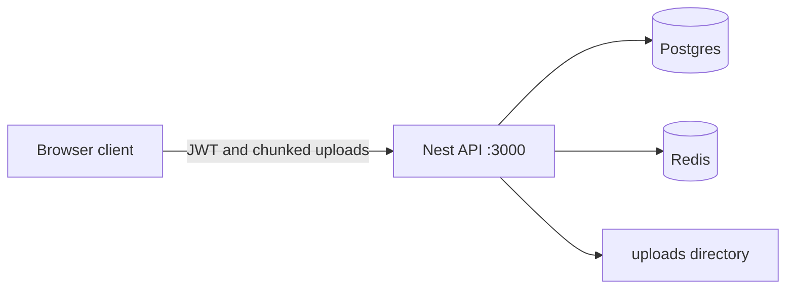

# Our Drive API

NestJS service for a personal file library. Accounts live in Postgres, upload sessions and file listings live in Redis, and file bytes live on disk.

The React client is the sibling project `../our-drive-web` and calls this API on port 3000.

## Architecture



| Piece | Responsibility |
| --- | --- |
| `AuthModule` | Register a user, check username and password, issue a JWT. |
| `FileModule` | List, rename, download, and delete files. Enforce public versus private visibility. |
| `UploadService` | Accept a file in chunks, remember the byte offset, and commit the file when the declared size is reached. |
| `RedisModule` | Store in-progress upload sessions, per-upload locks, and short-lived file listings. |
| Postgres | Store users and completed file metadata. TypeORM `synchronize` creates the tables in development. |
| `uploads/` | Hold partial chunks in `uploads/.partials` and finished files beside them. This directory is gitignored. |

A request for a file record is allowed when the file is public, or when the JWT belongs to the owner. Rename and delete require the owner. `OptionalJwtAuthGuard` lets anonymous callers read public files and still attaches the user when a bearer token is present.

### Resumable upload

Large files use an offset protocol so a dropped connection can continue from the last saved byte.

1. `POST /files/uploads` creates a session in Redis (`upload:session:{id}`, 24 hours) and an empty temp file.
2. `PUT /files/uploads/:uploadId` appends one chunk. The client sends `Upload-Offset` and `Content-Range: bytes start-end/total`.
3. The server locks that upload, writes the chunk at the current offset, and advances the offset only after the full chunk is buffered.
4. A retry of the same chunk is treated as a duplicate. A gap returns `409` with the offset the server still expects.
5. When the offset equals the declared size, the temp file is renamed into `uploads/` and a `files` row is saved.
6. `GET /files/uploads/:uploadId` reports the current offset. `DELETE` aborts an unfinished session.

Recommended chunk size is 5 MB. A chunk cannot exceed 8 MB, and a file cannot exceed 5 GB. `POST /files/upload` remains available for a single multipart upload.

### Cache

`GET /files` and `GET /files/:id` are cached in Redis for 120 seconds under `cache:files:`. The response header `X-Cache` is `HIT` or `MISS`. Creating, updating, or deleting a file clears that prefix. If Redis is down, those reads fail rather than serving an uncached fallback.

## HTTP API

| Method | Path | Auth | Purpose |
| --- | --- | --- | --- |
| `POST` | `/auth/register` | no | Create a user (`username`, `email`, `password`). |
| `POST` | `/auth/login` | no | Return a JWT string. Body is `{ username, password }`. |
| `GET` | `/auth/status` | JWT | Return the token payload. |
| `GET` | `/files` | optional | List files the caller is allowed to see. |
| `GET` | `/files/:id` | optional | Fetch one file record. |
| `GET` | `/files/:id/content` | optional | Download the bytes. The path must stay inside `uploads/`. |
| `PATCH` | `/files/:id` | owner | Change `fileName` and/or `visibility` (`private` or `public`). |
| `DELETE` | `/files/:id` | owner | Delete the record and the stored bytes. |
| `POST` | `/files/uploads` | JWT | Start a chunked upload. |
| `PUT` | `/files/uploads/:uploadId` | JWT | Append a chunk. |
| `GET` | `/files/uploads/:uploadId` | JWT | Read the current offset. |
| `DELETE` | `/files/uploads/:uploadId` | JWT | Abort an unfinished upload. |
| `POST` | `/files/upload` | JWT | Upload one file as multipart field `file`, with `visibility`. |

CORS allows `http://localhost:5173` and `http://127.0.0.1:5173`, and exposes `Upload-Offset`, `Upload-Length`, `X-Cache`, and `Content-Disposition`.

## Run locally

Start Postgres and Redis:

```bash
docker compose up -d
```

Postgres listens on `localhost:5432` (`postgres` / `postgres`). Redis listens on `localhost:6379`. Override the Redis host with `REDIS_HOST`, `REDIS_PORT`, and `REDIS_PASSWORD`.

```bash
npm install
npm run start:dev
```

The API listens on port 3000. Run the unit tests with `npm test`.
